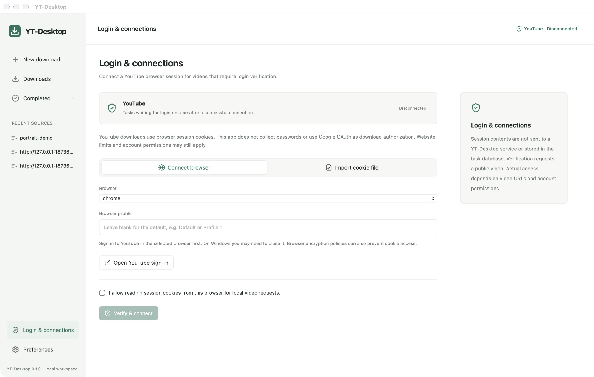

# YT-Desktop

基于 [yt-dlp](https://github.com/yt-dlp/yt-dlp) 的开源桌面下载客户端，使用 Tauri 2、React 和 Rust 开发，面向 Windows、macOS 和 Linux。支持简体中文、English 和跟随系统语言。

[构建状态](https://github.com/it8090/yt-desktop/actions) · [版本下载](https://github.com/it8090/yt-desktop/releases) · [问题反馈](https://github.com/it8090/yt-desktop/issues)

## 界面

客户端使用与设计一致的列表、下载队列和右侧设置布局。以下为真实桌面客户端的英文登录连接页面：



## 功能

- **地址解析**：单个视频、播放列表、频道、YouTube Shorts 列表；支持一次输入多个地址。
- **视频列表**：搜索标题、逐项勾选、全选当前搜索结果，长列表使用虚拟滚动。
- **单个与批量下载**：每行独立下载，也可下载所选项目或当前搜索结果。
- **登录连接**：连接本机 Chrome、Firefox、Edge 等浏览器会话，或导入 Netscape 格式的 Cookie 文件；验证成功后继续等待登录的任务。
- **下载队列**：并发控制、暂停、继续、取消、失败重试；网络错误采用退避重试，HTTP 429 会等待冷却并降低该站点并发。
- **下载设置**：画质上限、MP4 / MKV / 原始格式、仅音频、中英文字幕、视频封面、跳过重复任务。
- **文件校验**：下载完成后通过 ffprobe 检查媒体流、文件大小和时长，校验通过才标记完成。
- **本地记录**：SQLite 保存来源、任务和设置；重启后运行中的任务转为暂停，可手动继续。
- **已完成管理**：调用系统播放器、在文件夹中显示、导出 CSV。
- **系统集成**：托盘驻留、单实例、浅色 / 深色 / 跟随系统、系统 / 自定义 / 无代理。
- **版本更新**：启动自动检查、手动检查、更新说明、真实下载进度、签名验证和安装重启。
- **组件管理**：发现系统组件；也可在应用内安装或更新 yt-dlp、ffmpeg、ffprobe、Deno，安装前核对发布方提供的 SHA-256。

本项目没有应用账号或云端下载服务。所有下载进程都在本机运行。

## 安装与使用

从 [Releases](https://github.com/it8090/yt-desktop/releases) 选择相应系统的安装包。尚未发布的提交可在 [Actions](https://github.com/it8090/yt-desktop/actions) 中查看构建产物，或按照下文从源码运行。

| 系统 | 构建产物 | 说明 |
| --- | --- | --- |
| Windows x64 | NSIS `.exe` | 需要 Microsoft Edge WebView2 运行时 |
| macOS Apple Silicon | `darwin-aarch64.app.tar.gz` | 解压得到 `.app` |
| macOS Intel | `darwin-x86_64.app.tar.gz` | 解压得到 `.app` |
| Linux x64 | `.AppImage` / `.deb` | 构建基线为 Ubuntu 22.04，依赖 WebKitGTK 4.1 |

当前安装包没有配置商业代码签名或 Apple 公证。Windows / macOS 可能显示发布者提示；可以审查源码自行构建。其他 Linux 发行版可安装 Tauri 所需依赖后自行编译。Windows ARM64、Linux ARM64 尚未加入安装包构建矩阵；组件发布方缺少相应二进制时需手动提供系统组件。

Linux AppImage 使用前需赋予执行权限；应用内自动安装更新适用于这种安装方式：

```bash
chmod +x YT-Desktop_0.1.0_linux-x86_64.AppImage
./YT-Desktop_0.1.0_linux-x86_64.AppImage
```

首次启动后：

1. 打开 **偏好设置 → 下载组件**，检查四个组件，点击“安装缺少的组件”。也可预先通过包管理器安装它们。
2. 如需代理，在 **网络** 中选择系统或自定义代理并保存。系统模式优先读取 `https_proxy` / `HTTPS_PROXY` / `all_proxy` / `ALL_PROXY`，再读取系统 HTTP 代理；PAC 需要手动填写实际代理地址。
3. 在 **新建下载** 粘贴地址并获取视频列表，例如 `https://www.youtube.com/@yaqoob_developer/shorts`。
4. 选择保存位置、画质和格式，逐个下载或勾选批量下载。
5. 在 **下载任务** 查看进度、暂停或重试，在 **已完成** 打开经过校验的本地文件。

文件按“保存位置 / 来源名称 / 画质格式”分组，文件名包含视频 ID。再次添加相同视频、选项和目录时会跳过已有活动任务；开启“跳过已下载的视频”时，也会跳过仍存在的已完成文件。取消此选项后重新下载会使用独立文件名，避免覆盖已有视频。

## YouTube 登录与连接

YouTube 下载授权使用浏览器会话 Cookie。[yt-dlp 的当前 YouTube 说明](https://github.com/yt-dlp/yt-dlp/wiki/Extractors#youtube) 不支持将 OAuth 登录作为下载认证。本应用不收集 Google 账号密码。

**连接浏览器**：先在所选浏览器中登录 YouTube，再在本应用中选择浏览器和配置，勾选本机会话读取授权，点击“验证并连接”。配置可以留空使用默认值，也可填 `Default` 或 `Profile 1` 等配置名称。每条下载任务开始时重新读取浏览器会话。

**导入 Cookie**：选择 Netscape 格式的 `.txt` 文件。应用只保留未过期的 YouTube / Google 相关 Cookie。默认仅在当前进程内保留；勾选保存后使用 macOS Keychain、Windows Credential Manager 或 Linux Secret Service。安全存储不可用时会明确报错，不会回退到明文数据库存储。

验证会请求一个公开视频。验证通过表示当前请求可访问，不能保证所有视频都能下载。登录失效时任务会等待重新连接。

常见问题：

| 提示 | 处理方式 |
| --- | --- |
| `Sign in to confirm you're not a bot` | 更新组件，重新连接浏览器会话，确认代理与浏览器访问环境一致 |
| 浏览器会话无法解密 / 读取 | 检查系统访问授权；Windows 可尝试关闭浏览器后重试，或导入 Cookie 文件。部分 Chromium 加密策略会阻止读取 |
| HTTP 429 | 等待应用冷却重试；不要持续刷新、提高并发或反复重新入队 |
| 网络 / SSL / 代理错误 | 检查偏好设置中的代理地址、端口和网络连通性 |
| 视频不可用 / 私有 / 地区限制 | 确认当前账号拥有访问权限；应用不会绕过访问控制 |
| 文件校验失败 | 查看任务技术详情并重试，检查源视频、磁盘空间和下载组件 |

连接成功并不取消网站的机器人验证、限流、地区限制、版权限制或账号权限要求。动态网站的可下载性也会随 yt-dlp 和网站变化。

## 版本自动更新

在 **偏好设置 → 版本更新** 中开启或关闭启动检查，也可手动检查。发现新版本后显示版本号与更新说明；点击“下载更新并重启”后下载对应平台安装包。应用验证签名与签名绑定的版本号，通过后暂停媒体任务、安装并重启。更新失败会保留当前版本并显示错误。

更新清单固定为本项目 GitHub Release 的 `latest.json`，安装包必须来自本仓库的 HTTPS Release 地址。私钥不在仓库中，客户端只包含公钥。Linux 需要从 AppImage 运行才能在应用内安装更新；`.deb` 用户可下载安装新版包。

发布者流程：从 Actions 下载并解压四个平台的产物，在持有签名私钥的机器上执行：

```bash
python3 scripts/prepare-release.py /path/to/extracted-artifacts /path/to/release-output --key /secure/path/updater.key --version 0.1.0
```

创建相应的 `v0.1.0` GitHub Release，并把输出目录中的安装包、`.sig`、`latest.json` 和 `SHA256SUMS` 一起上传。后续版本更新 `package.json`、`src-tauri/Cargo.toml` 和 `tauri.conf.json` 的版本号，使用同一私钥重新签名发布。私钥应单独备份，不要提交到 Git，也无需发送到构建服务。

## 从源码运行

需要 Node.js **22.12+**（推荐 Node 22 LTS）、Rust stable（1.90+），以及 [Tauri 2 系统构建依赖](https://v2.tauri.app/start/prerequisites/)。

```bash
git clone https://github.com/it8090/yt-desktop.git
cd yt-desktop
npm ci
npm run desktop:dev
```

系统依赖概要：

- **Windows**：Visual Studio C++ Build Tools、WebView2。
- **macOS**：Xcode Command Line Tools。
- **Ubuntu 22.04**：`build-essential libwebkit2gtk-4.1-dev libxdo-dev libssl-dev librsvg2-dev libayatana-appindicator3-dev libdbus-1-dev patchelf`。

`npm run dev` 只启动浏览器界面预览，下载和文件操作需要 `npm run desktop:dev` 的原生客户端。

构建安装包：

```bash
npm run desktop:build
# 仅生成当前系统特定格式，例如：
npm run desktop:build -- --bundles app   # macOS
npm run desktop:build -- --bundles nsis  # Windows
npm run desktop:build -- --bundles deb   # Linux
```

输出位于 `src-tauri/target/release/bundle/`。不同系统需要在对应系统上构建，CI 已配置 Windows、macOS 两种架构和 Linux 构建任务。

## 检查与测试

```bash
npm run build
npm test
npm run format:check
cargo fmt --manifest-path src-tauri/Cargo.toml --check
cargo clippy --manifest-path src-tauri/Cargo.toml --all-targets -- -D warnings
cargo test --manifest-path src-tauri/Cargo.toml --lib
```

安装好系统 `yt-dlp`、`ffmpeg`、`ffprobe` 后，可运行真实本地媒体集成测试：

```bash
python3 scripts/smoke.py
```

完整发布与升级验收结果见 [0.1.0 验收记录](docs/0.1.0验收记录.md)。

该测试现场生成带音频的视频，开启本地 HTTP 服务，执行真实列表解析、下载、暂停继续、ffprobe 校验、CSV 导出和重启记录恢复，不访问用户账号。测试素材和运行时数据不会提交到仓库。界面测试覆盖单行下载、跨可视区全选、搜索结果批量下载、未知大小进度显示和会话授权勾选。

## 项目结构

```text
src/                 React 界面、中英文翻译、原生 IPC 桥接
src/components/      共用组件与下载选项
src/pages/           列表、队列、已完成、连接、偏好设置
src/test/            界面与翻译测试
src-tauri/src/       Rust 队列、SQLite、会话、进程、下载组件
src-tauri/tests/     真实媒体下载集成测试
scripts/smoke.py     本地媒体测试入口
.github/workflows/   跨平台构建检查
```

## 数据与隐私

- 配置、任务和来源保存在 Tauri 的应用数据目录，标识为 `io.github.it8090.ytdesktop`。
- 数据目录包含 `library.sqlite`、应用管理的 `tools/` 和临时 `runtime/`；下载目录可单独设置。
- 浏览器模式只保存浏览器名称和配置。导入的会话使用进程内存或系统安全存储。
- 为传递给下载器生成的临时 Cookie 文件会在任务结束时清理，启动时也会清理上次中断遗留的应用 Cookie 临时文件。
- 媒体列表只保存公开元数据与来源页地址，不保存完整格式响应或带签名的视频流地址。技术错误会清除 HTTP URL 查询参数和认证请求头。
- 下载地址本身和来源记录保存在本机。分享数据库或导出 CSV 前，请自行检查其中的链接和文件路径。
- 应用会访问所填写的网站、视频封面，以及安装组件时的 GitHub 发布接口和下载源。没有自建统计或云端同步服务。

## 范围与限制

- 支持范围取决于 yt-dlp；当前会话连接管理优先面向 YouTube，其他站点按公开访问方式解析。
- 最多一次输入 100 个地址、获取 20,000 个视频，并发上限为 4。
- 部分网站不提供总大小，下载期间会显示不确定进度。处理和校验阶段也不会伪造百分比。
- 暂停保留部分下载文件；是否可以从字节位置继续取决于源服务器和协议，必要时 yt-dlp 会重新下载。
- 字幕选项下载网站提供的中英文字幕 / 自动字幕，不生成新的转录。
- 容器选项用于合并与封装，不承诺将所有源编码转成 H.264。兼容编码优先失败时，可使用其他可用编码重试。
- 没有内置验证码代答、DRM 解密、私有视频权限绕过、自动订阅抓取或无人值守账号登录。
- 应用更新使用签名安装包；Linux 的应用内更新需要运行 AppImage，`.deb` 安装请通过新安装包更新。

## 开源许可

本项目代码采用 [MIT License](LICENSE)。yt-dlp、FFmpeg / ffprobe、Deno 是独立下载和运行的外部组件，遵循各自许可证；本仓库和应用安装包不包含这些组件二进制。

组件下载来源：

- [yt-dlp/yt-dlp](https://github.com/yt-dlp/yt-dlp/releases)：按当前操作系统选择独立可执行程序。
- [eugeneware/ffmpeg-static](https://github.com/eugeneware/ffmpeg-static/releases)：提供 ffmpeg / ffprobe 预编译组件；具体构建许可请查看发布方说明。
- [denoland/deno](https://github.com/denoland/deno/releases)：JavaScript 运行时。

请仅下载自己有权保存的内容，并遵守相应网站的条款。
