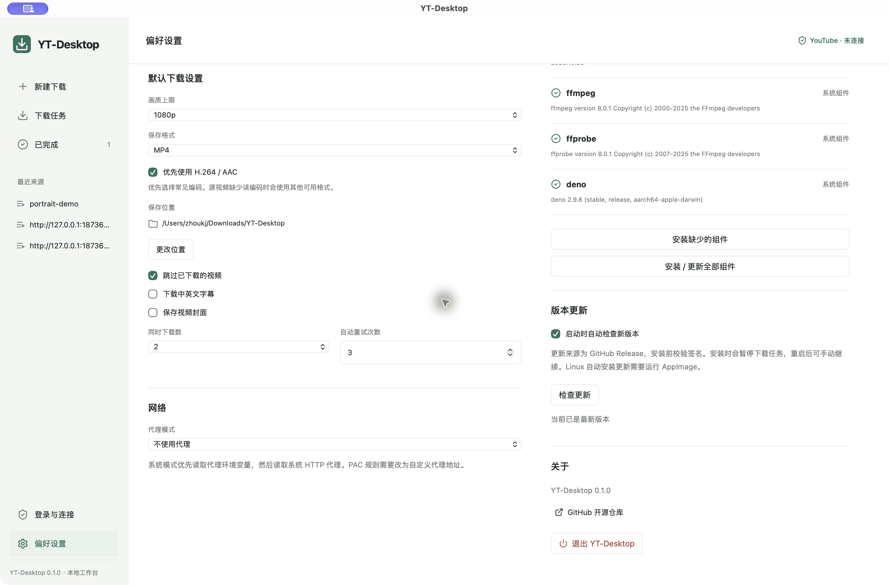

# 0.1.0 验收记录

代码：`2eb78b6`。测试素材均为本机现场生成的测试图案与音频，不包含用户视频或账号会话。

| 检查 | 结果 |
| --- | --- |
| 前端生产构建、TypeScript | 通过 |
| 前端行为测试 | 8 项通过：单行下载、跨可视区全选、搜索后批量下载、未知大小进度、授权勾选、更新提示与失败状态、翻译键一致性 |
| Rust 单元测试（macOS） | 16 项通过：参数校验、会话文件筛选、任务去重与恢复、运行中进程暂停、日志脱敏、更新来源校验等 |
| Rust 格式与 Clippy 检查 | 本地及四个平台 CI 均通过 |
| 真实本地媒体集成测试 | 通过：HTTP 地址解析、真实 yt-dlp 下载、暂停继续、ffprobe 媒体流与时长校验、CSV 导出、数据库重新打开恢复记录 |
| 原生 macOS 手工操作 | 已验证列表获取、单个下载、完成文件信息、设置保存、中英文切换 |
| 托盘与重新打开 | 已在隔离的 0.0.9 客户端验证关闭到托盘后重新显示窗口 |
| Windows / Linux / macOS 双架构构建 | 全部通过：[构建记录](https://github.com/it8090/yt-desktop/actions/runs/44004721664) |
| 签名版本更新 | 通过：隔离的 0.0.9 原生客户端发现 0.1.0，下载真实 Release 包、验证签名、替换应用并自动重启；安装后的可执行文件与签名的 CI 产物一致。交付客户端显示 0.1.0 且检查结果为“当前已是最新版本” |

## 验证范围

Windows 和 Linux 使用 GitHub Actions 原生环境编译、测试及打包，尚未在本机实测其桌面界面。

登录连接的 Cookie 格式、筛选、失效处理和明确授权流程已覆盖代码测试；本次新客户端验收没有读取用户的真实浏览器会话，也没有实测 Windows 浏览器加密策略或各系统安全存储服务。网站限流、机器人验证和账号访问权限以实际网站响应为准。

自动更新的端到端验收使用独立的 0.0.9 应用标识和数据目录。它与正式版使用相同更新公钥，验证签名包下载、应用替换和重新启动；任务数据库恢复另由相同数据目录下的真实媒体集成测试验证。

## 发布核验

- [v0.1.0 正式发布](https://github.com/it8090/yt-desktop/releases/tag/v0.1.0)，不是预发布或草稿。
- [发布流水线](https://github.com/it8090/yt-desktop/actions/runs/44011248594) 从上述成功的构建中下载原始产物，加入本机生成的签名与清单；全部校验通过才发布。
- 11 个附件的文件大小及 GitHub 记录的 SHA-256 均与本机签名目录一致；公开 `latest.json` 与本机制品逐字节一致，包含四个平台。
- 签名私钥始终保存在本机仓库之外，没有上传到 GitHub 或 CI。

隔离验收版在安装后使用正式版应用标识。已记录更新后进程重新启动及版本 0.1.0，并比对可执行文件；随后退出验收进程，另从交付目录启动同一正式版，确认原生界面、已有测试任务以及最新版本状态。未把不同应用标识间的数据目录切换当作数据库迁移测试。
